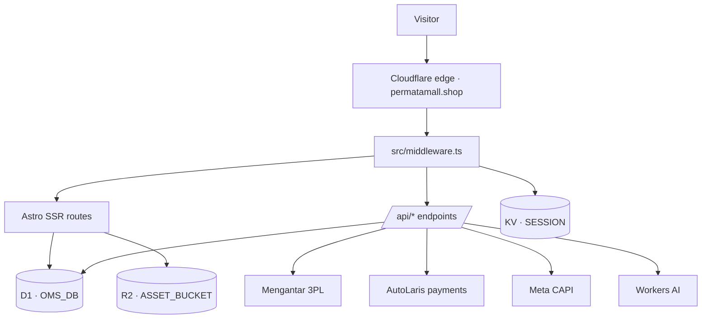

# AdsBookCMS — System Architecture

> **Product:** AdsBookCMS (single) — a self-contained direct-response commerce CMS that installs onto Cloudflare Workers.
> **Install model:** **1 installer = 1 Worker = 1 store.** Isolation comes from the deployment boundary, not from request-time tenant routing.
> **Reference install:** `permatamall.shop` (Worker `cmsads-permatamall`), carrying the bundled demo dataset (ADR-011). The `cmsads-*` resource names are legacy and deliberately not renamed.
> **Last verified against disk:** 2026-08-16 @ `0d2e56a`.

This document describes what the system **actually is**. Where the intended AdsBookCMS product differs from what ships today, the gap is stated explicitly in §10 rather than written as if it were already true. Code and executable evidence win over this document; when they disagree, fix the document.

---

## 1. Install Model

An AdsBookCMS install is one Cloudflare Worker with its own private resources:

| Resource | Binding | Instance value (reference deployment) |
| --- | --- | --- |
| Worker | — | `cmsads-permatamall` |
| D1 database | `OMS_DB` | `cmsads-permatamall-d1` |
| KV namespace | `SESSION` | sessions, rate-limit counters, idempotency keys |
| R2 bucket | `ASSET_BUCKET` | product uploads + CMS media |
| Workers AI | `AI` | content generation for the admin workbench |
| Static assets | `ASSETS` | `dist/client`, served by the Cloudflare adapter |

There is **no `env.<tenant>` block** in `wrangler.jsonc` and `definedEnvironments` in the built config is empty. One repository checkout deploys exactly one store. A second store means a second install: separate Worker, separate D1, separate bucket, separate domain.

**Why single-install instead of shared multi-tenant.** A shared runtime would require every query, cache key, session key, R2 object key, webhook lookup, and provider credential to carry a verified store scope. Today the data layer legitimately assumes one logical merchant (`SELECT ... FROM stores ORDER BY id LIMIT 1` is the canonical store read). Cloudflare also does not allow selecting a D1 binding from request input, so "one Worker, many databases" is not available without Workers for Platforms. The platform boundary is therefore the isolation boundary. See `DECISIONS.md` ADR-001.

---

## 2. Runtime Topology



Every route is server-rendered: `astro.config.mjs` sets `output: 'server'` with the Cloudflare adapter. Nothing is prerendered, which is why the sitemap is hand-authored at `src/pages/sitemap.xml.ts` instead of using `@astrojs/sitemap`.

### Middleware responsibilities (`src/middleware.ts`)

Runs on every request, in order: canonical host redirect (`www` → apex), ad click-ID capture into first-party cookies, admin session validation against KV + `admin_credentials`, role-based admin route policy, same-origin enforcement on unsafe admin API methods, and the embed frame policy (replaces `X-Frame-Options: DENY` with a `frame-ancestors` CSP built from `stores.embed_allowed_origins`, failing closed to an empty allowlist on database error).

---

## 3. Route Surface

| Family | Entry points |
| --- | --- |
| Storefront | `/`, `/produk`, `/produk/[slug]`, `/404`, `/thanks`, `/payment` |
| Content pages | `/tentang`, `/kontak`, `/testimoni`, `/sitemap`, `/disclaimer`, `/kebijakan-privasi`, `/kebijakan-cookie`, `/syarat-ketentuan`, `/pengiriman` |
| Landing pages | `/[slug]` — catch-all resolved from D1 `landing_pages`; falls back to a 308 to `/produk/<slug>` when the slug is a product, else 404. Supports `?preview=1` behind an admin session |
| Checkout forms | `/hybrid-form`, `/middle-form`, `/full-form`, `/geoipform`, `/embed/form`. `/form-hybrid`, `/form-middle`, `/form-full` are query-preserving 308 redirects that **do** exist |
| Feeds | `/sitemap.xml`, `/feed/google-catalog.xml`, `/feed/meta-catalog.xml`, static `/robots.txt` |
| Media | `/assets/[...key]` (R2 `uploads/` prefix), `/media/[...key]` (R2 `content/` prefix) |
| Admin | `/hello` (login), `/admin/*` — 27 pages |
| Public API | `/api/*` — checkout, locations, shipping rates, payment methods, order status, Meta events |
| Headless API | `/api/v1/*` — storefront descriptor, products, geo, shipping rates, checkout, tracking events |
| Webhook | `/api/webhooks/autolaris` |

The headless `/api/v1/*` family is **implemented and shipping**, authenticated by `X-App-Key`/`Bearer` against the `developer_api_keys` table (`src/lib/headless-api.ts`) plus an origin allowlist. Keys are issued at `/admin/settings/developer`.

---

## 4. Data Layer

D1 is the only persistent store for operational state. **All runtime data access is raw `D1Database.prepare()` / `.batch()`** across 43 modules. Drizzle ORM is present but is *not* a query layer: `src/db/index.ts` (`getDb()`) has zero importers, and `src/db/schema.ts` exists only as input for `drizzle-kit generate`.

### Tables (17)

`stores` · `warehouses` · `products` · `product_variants` · `orders` · `order_items` · `courier_rules` · `pickup_schedules` · `admin_credentials` · `payment_transactions` · `storefront_content` · `provider_dispatch_locks` · `seller_bank_accounts` · `capi_event_outbox` · `developer_api_keys` · `landing_pages` · `landing_sections`

`stores` is a single-row table that carries the runtime-editable half of the configuration: provider keys and base URLs, tracking IDs, fee-bearer policy, payment toggles, CRM templates, embed origins, AI content instructions, and COD province exclusions.

Stock integrity is enforced by the database, not the application: trigger `product_variants_stock_nonnegative` (migration `0003`) raises `INSUFFICIENT_STOCK` on any negative stock write.

### Migration chain

34 files, `0000`–`0033`, applied with `wrangler d1 migrations apply OMS_DB`, which reads the directory rather than the Drizzle journal. Four migrations write data rather than schema: `0007` (bootstrap admin credential), `0017` (a sample product), `0018` (role rename), `0031` (order-number rewrite).

**Known drift, do not trust `schema.ts` as truth:**

- `landing_pages` and `landing_sections` exist in migrations but not in `schema.ts`.
- `stores.is_cod_enabled`, `stores.is_autolaris_enabled`, `stores.disabled_autolaris_channels` exist in migrations but not in `schema.ts`.
- The Drizzle journal stops at `0030`; six later migrations were hand-authored with no journal entry, so `npm run db:generate` would emit a destructive diff today. Write migrations by hand until the journal is rebuilt.

---

## 5. Configuration Resolution — the sharpest edge in the system

Configuration comes from **three independent sources** that are easy to mistake for one:

| Source | Read path | Changes take effect after |
| --- | --- | --- |
| **Build-time bundle** | `tenantConfig` in `src/lib/tenant.ts` | `astro build` + deploy |
| **Worker runtime env** | `getRuntimeEnv(locals)` in `src/lib/env.ts` | deploy (no rebuild needed) |
| **D1 `stores` row** | `provider-config.ts`, `store-ads.ts`, `public-store.ts` | immediately |

`tenantConfig` calls `getEnvValue(key)` **without an env argument**, which skips the Cloudflare runtime env entirely and resolves from `import.meta.env` — a literal object frozen into the bundle by Astro at build time. Both `wrangler.jsonc` `vars` and the local `.env` feed that object; verified 2026-08-16 by changing a var in `wrangler.jsonc` alone and observing the new value baked into `dist/server/chunks/env_*.mjs`. Which of the two wins when both define the same key was not determined. Consequences that must be understood before touching identity:

- Site name, URL, description, logo, tagline, theme color, locale, storefront template, and admin name are **baked at build time**. Editing `vars` and redeploying an already-built bundle changes nothing — the value only moves after `npm run build`.
- `slug` is hardcoded to `"permatamall"` with no override path.
- `stores.name` in D1 and `tenantConfig.name` are **different values**. Renaming the store in `/admin` changes CRM messages and admin display but leaves every storefront `<title>`, header, footer, JSON-LD, and OG tag untouched.
- An unknown `PUBLIC_STOREFRONT_TEMPLATE` throws at module load, which in a Worker means every route returns 500.

Provider credentials follow a **D1-first, env-fallback** rule: a key saved in the admin dashboard wins over the deployed secret, and `provider-config.ts` reports which one won as `source: "dashboard" | "server" | "none"`.

---

## 6. Authentication and Access

Session is a signed JWT in the `adsbook_session` cookie (`SESSION_COOKIE_NAME` in `src/lib/auth.ts` — the single source for the name), verified in middleware against a KV record and the `admin_credentials` row. `admin_credentials.updated_at` doubles as a session revision: rotating a credential invalidates existing sessions. Roles are defined in `src/lib/auth.ts` (`ADMIN_ROLES`) and enforced per route by `canAccessAdminRoute`.

The login route is `/hello` rather than `/admin/login`, and `robots.txt` disallows `/admin/`, `/api/`, `/embed/`, and `/hello`.

`src/lib/auth.ts` — the entire signing, verification, and role-policy layer — currently has **no test coverage**. It is the highest-risk untested module in the repository.

---

## 7. Commerce Flow

1. **Catalog** — `products` + `product_variants` in D1 carry identity, price, weight, and stock. `src/lib/catalog.ts` merges those operational rows with published presentation JSON from `storefront_content`.
2. **Form** — `/hybrid-form` resolves COD eligibility from trusted Cloudflare geo; a known eligible province routes to the middle form, a disabled or unknown province routes to the full form (`src/lib/form-mode.ts`).
3. **Rates** — `/api/shipping-rates` quotes Mengantar for the resolved destination, filtered by `courier_rules` and store-level COD province exclusions.
4. **Submit** — `/api/submit-order` persists order, items, and stock reservation atomically. It is rate-limited, honeypot-guarded, and idempotent via `submit_token`. **Checkout never dispatches to the courier.**
5. **Payment** — online orders create one AutoLaris transaction; `/api/webhooks/autolaris` reconciles payment state idempotently. Paid status changes dispatch *eligibility*, never dispatch itself.
6. **Dispatch** — an operator explicitly pushes eligible orders to Mengantar from `/admin/orders`. Requests run sequentially under a `provider_dispatch_locks` lease. Only an accepted provider response moves an order to `processing`.
7. **Tracking** — browser Pixel plus server-side Meta CAPI through `capi_event_outbox`, a durable transactional outbox with retry and a shared per-order `event_id` for deduplication.

---

## 8. Content Management

Two independent content systems:

- **Storefront content** (`storefront_content`) — draft/published JSON per content key, versioned, optionally generated by Workers AI from the live catalog, published explicitly from `/admin/content`. Product presentation **fails closed**: a product with no published row is omitted from the storefront.
- **Landing pages** (`landing_pages` + `landing_sections`) — an ordered section builder with `html` and `form` section types, rendered by the `/[slug]` catch-all.

Home content does **not** currently fail closed: when no published home row exists, `src/lib/tenant-content.ts` silently serves `DEFAULT_HOME_CONTENT` compiled into the bundle. For an installer product this is the wrong default — a fresh install should render an honest setup state. Tracked in §10.

---

## 9. Build and Release

```
push to main → .github/workflows/deploy.yml → npm ci → npm run check → npm test → npm run build → npx wrangler deploy
```

**Pushing to `main` deploys production.** There is no staging environment, no PR gate, and no manual approval step. Any documentation claiming otherwise is wrong. Release detail lives in `RELEASE.md`.

Local verification, in the order CI runs it:

```bash
npm test          # node --test over src/lib/*.test.ts
npm run check     # astro check && tsc --noEmit
npm run build     # astro build
```

npm is authoritative (`package-lock.json`, `npm ci` in CI). This is a single-package repository — `pnpm-workspace.yaml` is a non-functional stub and `pnpm-lock.yaml` is stale.

---

## 10. Gap Register — what AdsBookCMS still needs

These are the differences between the current single-store deployment and the intended installable product. None of them is implemented; do not document them as if they were.

| # | Gap | Why it blocks the installer | Primary surface |
| --- | --- | --- | --- |
| G1 | Identity is build-time | A new install cannot state its own name, domain, or logo without a rebuild | `src/lib/tenant.ts`, `src/lib/env.ts` |
| G2 | No `/install` wizard | Onboarding requires an operator with a terminal and Cloudflare credentials | new route + `src/lib/installer.ts` |
| G3 | No schema auto-upgrade | Each install is upgraded manually; nothing compares `schemaVersion` to the applied chain at boot | `src/lib/version.ts`, migration runner |
| ~~G4~~ | ~~Sample product is another merchant's~~ | **Closed 2026-08-16.** Migration `0034` removes the foreign row under identity and order-reference guards; the immutability concept was dropped rather than repointed, since the demo catalog already serves the purpose and is fully editable | `src/db/migrations/0034_remove_foreign_sample_product.sql` |
| G5 | Home content falls back to compiled copy | A fresh install shows inherited marketing copy instead of a setup state | `src/lib/tenant-content.ts` |
| G6 | Theme set is compile-time | Templates cannot be added or switched without a rebuild | `src/lib/tenant-contract.ts` |
| G7 | No observability | No Workers logs, no error reporting, no way to diagnose a customer install | `wrangler.jsonc` (no `observability` block) |
| G8 | Drizzle journal broken | Migration generation is unusable; the upgrade path depends on hand-authored SQL | `src/db/migrations/meta/` |
| ~~G9~~ | ~~Meta Purchase deduplication is broken~~ | **Closed 2026-08-16.** Both legs now key on the `INV-` order number. Historical data stays inflated — Meta offers no retroactive merge | `src/components/tracking/MetaThanksTracker.astro` |
| G10 | Embedded checkout fires Purchase with no event ID, at redirect time | An event without `event_id` cannot deduplicate against CAPI, and firing on redirect counts unpaid online orders | `src/lib/embed-markup.ts` |

---

## 11. Non-Goals

- Request-time tenant routing by `Host` inside one Worker.
- Selecting a D1 binding from request input.
- Workers for Platforms / customer-authored Worker code.
- Public self-service signup. Installs are provisioned deliberately, one at a time.
