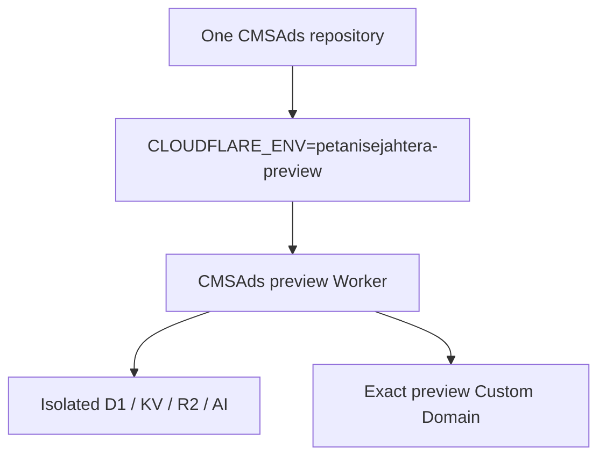

# Cloudflare Deployment-per-Tenant Architecture

## 1. Status and Decision

- **Observed:** CMSAds is an Astro SSR application deployed through the Cloudflare adapter. The application uses stable bindings named `OMS_DB`, `SESSION`, `ASSET_BUCKET`, and `AI`.
- **Observed:** Current data access frequently selects the first store or warehouse. This is safe only while one isolated database contains one logical merchant.
- **Decision:** Use **deployment-per-tenant isolation**: one repository, one Wrangler environment, one independently named Worker, and one D1/KV/R2/Workers AI resource set per tenant.
- **Decision:** Select the tenant at Astro dev/build time with `CLOUDFLARE_ENV=<tenant>`. Deploy the flattened `dist/server/wrangler.json` produced by that build; do not try to switch tenants after the build.
- **Decision:** Keep application binding names stable. Wrangler maps the same names to tenant-specific Cloudflare resources.
- **Decision:** Each CMSAds tenant declares `INGRESS_MODE`: `custom-domain` attaches reviewed exact hostnames; `service-only` exposes no public route and is reached through another Worker's service binding.
- **Decision:** Disable `workers.dev` fallback with top-level `workers_dev: false`; no CMSAds Worker receives an unreviewed public endpoint.
- **Non-goal:** Do not route tenants by `Host` inside one Worker and do not select D1 IDs from request input.
- **Non-goal:** Do not adopt Workers for Platforms yet. CMSAds deploys operator-owned code, not customer-authored Worker code.

This model is intentionally boring. It provides hard resource isolation without rewriting every SQL query for shared-database tenancy.

Portable repository and new-account onboarding are canonical in [`INSTALLATION.md`](./INSTALLATION.md). The separate-storefront, locked-form, adapter, and Meta Ads boundary is canonical in [`STOREFRONT_INTEGRATION.md`](./STOREFRONT_INTEGRATION.md).

## 2. Deployment Topology



### Isolation invariant

A request handled by one tenant Worker can access only bindings configured for that environment. No application branch maps a hostname to a database. Provider credentials and local development secrets are also environment-specific.

### Why not one shared Worker and D1?

A shared runtime would require a clean migration of every query, unique index, cache key, session key, R2 object key, webhook lookup, background job, and provider credential to a verified tenant scope. Current first-row queries make that model unsafe. Separate bindings enforce the boundary at the platform layer instead.

### When to reconsider

Revisit a shared control plane or Workers for Platforms only when tenant count, provisioning frequency, or customer-controlled code makes manually reviewed Wrangler environments the bottleneck. That is a new architecture, not an incremental flag.

## 3. Wrangler Environment Contract

The root `wrangler.jsonc` is the deployment source of truth.

- The top-level configuration remains the default local development profile.
- Each key under `env` is a tenant slug with an explicit Worker name, ingress mode, and complete non-inherited configuration.
- `vars`, D1, KV, R2, Workers AI, and routes are non-inheritable. Each tenant must repeat the full required set.
- Binding names remain `OMS_DB`, `SESSION`, `ASSET_BUCKET`, and `AI` across every tenant.
- Local secrets belong in `.dev.vars.<tenant>` and must never be committed.
- Production secrets are set only for one explicitly approved environment without printing their values.
- `custom-domain` tenants use exact hostnames. `service-only` tenants must configure no public routes and are callable only through reviewed Worker service bindings.
- Astro receives `CLOUDFLARE_ENV=<tenant>` during build. The generated flattened Wrangler config is then used without reapplying the environment suffix; direct deploy commands can create duplicate names and are prohibited.

Current committed tenant environments:

| Tenant slug | Explicit Worker | Ingress | Public route |
| --- | --- | --- | --- |
| `petanisejahtera-preview` | `cmsads-petanisejahtera-preview` | `custom-domain` | `preview.petanisejahtera.com` |


`petanisejahtera.com` is intentionally not a CMSAds deployment target. The standalone [`ongkipro/petanisejahtera`](https://github.com/ongkipro/petanisejahtera) repository and `petanisejahtera` Worker own the apex and `www` Custom Domains. The detached `cmsads-petanisejahtera` Worker and its D1/KV/R2 resources remain preserved; they must not be deleted or reattached without separate approval.

`wrangler.jsonc` plus `scripts/tenant.ts` are the canonical tenant-registry contract. Validation rejects a route on `service-only` workers and requires an exact canonical Custom Domain for `custom-domain` workers.

Required non-secret public variables:

| Variable                  | Purpose                                                               |
| ------------------------- | --------------------------------------------------------------------- |
| `PUBLIC_TENANT_SLUG`      | Stable tenant identifier used for diagnostics and generated metadata. |
| `PUBLIC_SITE_NAME`        | Storefront and structured-data publisher name.                        |
| `PUBLIC_SITE_URL`         | Absolute canonical origin without a trailing slash.                   |
| `PUBLIC_SITE_DESCRIPTION` | Default SEO and Open Graph description.                               |
| `PUBLIC_SITE_LOGO`        | Root-relative or absolute public logo URL.                            |
| `PUBLIC_SITE_TAGLINE`     | Short shared header/footer brand line.                                |
| `PUBLIC_SITE_THEME_COLOR` | Valid CSS color used by browser metadata.                             |
| `PUBLIC_SITE_LOCALE`      | HTML language and Open Graph locale source.                           |

Do not place API keys, passwords, webhook secrets, customer data, or payment data in these variables.

## 4. Frontend Tenant Boundary

### Canonical admin, variable storefront

The repository owns one admin product system for every tenant. `/admin/*` uses the same navigation source, ADScms accent, typography, spacing, density, responsive breakpoints, page hierarchy, table/card behavior, feedback states, accessibility contract, and order lifecycle. Tenant storefront theme colors and template choices must not alter this shell. Tenant variation in admin is limited to the visible merchant identity, public storefront link, role permissions, and data/provider/content loaded from that Worker's isolated bindings.

Admin product changes therefore land once in shared source and apply to every tenant build. Do not fork an admin component, route, navigation model, status vocabulary, or workflow for a tenant. A tenant-specific operational exception belongs in typed data or provider configuration only when the business contract genuinely differs.

The admin login is part of that canonical product boundary. Every tenant serves the same repository-owned `/admin-login.webp` background, device-responsive crop/overlay rules, credential-card geometry, touch/input sizing, and safe-area behavior. Tenant configuration may change the visible admin name and site URL only; it must not swap the login art, recolor the card from storefront tokens, or introduce a tenant-specific login layout.

Search and session exit are canonical admin behavior as well. Desktop command search uses the shared centered dialog; mobile command search uses the shared bottom Sheet and the same route index; the mobile all-menu exposes `Keluar` through the shared `POST /api/admin/logout` contract. Tenant configuration may not hide, fork, relabel, or redirect these controls.

Order and Shipping selection behavior is also shared: no implicit pickup selection, filter-aware bulk masters, explicit provider/pickup actions, and the same mobile/desktop selection states. A tenant may change which orders are eligible through isolated data and provider configuration, but it may not fork the selection controls or trigger mutations from selection alone.

The public frontend has the opposite presentation boundary. Storefront template, theme color, identity, published copy, and media may differ per tenant, while checkout validation, persistence, security, tracking, and provider contracts remain shared.

### Integrated versus headless ownership

| Topology | Status | Public route owner | CMSAds role |
| --- | --- | --- | --- |
| `custom-domain` integrated | Implemented | CMSAds Worker | Renders storefront, forms, admin, and API on one reviewed domain. |
| `service-only` headless | Supported; no active reference deployment | Separate storefront Worker | Exposes no public route; reviewed operational families use a private service binding. |
| Locked headless form and data adapters | Planned | Storefront gateway around CMSAds-owned contracts | Adds public bootstrap/catalog reads, three locked form routes, framework-neutral handoff, and consent propagation after contract proof. |

The custom storefront owns public layout, route hierarchy, components, motion, accessibility, and copy presentation. CMSAds remains authoritative for D1 product/variant identity, price, stock, weight, destination, shipping/payment eligibility, middle/full/hybrid form behavior, order persistence, operator lifecycle, and server tracking.

No headless gateway is currently deployed or registered as proof. A future gateway must independently prove every operational and canonical checkout route it delegates. Public non-secret bootstrap/catalog contracts, an executable framework-neutral adapter, and consent propagation remain planned.

The following public shell concerns are selected from typed tenant configuration:

- document language;
- default page title and description;
- canonical origin;
- Open Graph site name and locale;
- Organization/WebSite JSON-LD name, URL, and logo;
- storefront favicon/logo and theme color;
- storefront header/footer brand labels;

### Runtime tenant content

Storefront layout remains build-selected, but tenant copy is runtime-owned. Shared Git code contains strict home/product schemas, renderers, and commerce behavior. Each Worker's D1 stores one non-secret tenant generation instruction plus validated draft/published JSON; its R2 bucket stores tenant media. The instruction, generated copy, and merchant claims are never committed as another source pack.

Workers AI generation loads the active Worker's instruction and operational product facts, validates structured output, and saves a draft only. Public routes read only explicitly published JSON. Price, stock, identifiers, activation, warehouse/courier rules, payments, ads configuration, credentials, and orders remain operational D1 truth outside the content schema.

`PUBLIC_CONTENT_PACK=runtime-managed` identifies new merchant environments. Public rendering never falls back to compiled merchant copy: missing home content produces an explicit setup state, and products remain hidden until their D1 presentation is published. A second merchant therefore cannot inherit or relabel Petani Sejahtera claims.

Public route isolation also follows the selected content pack. `runtime-managed` Workers fail closed with `404` for the committed Petani Sejahtera campaign routes and their legacy `/images/*` prefixes. The configured selective `assets.run_worker_first` patterns send only those legacy asset requests through middleware; the Petani content pack forwards allowed files to its own `ASSETS` binding, while other tenant Workers cannot expose them. Shared public pages resolve tenant branding and canonical origins from the selected Worker configuration, and generic form routes never select a hard-coded fallback product.

MDX remains optional only for editorial long-form content such as articles and guides. It is not a source of operational commerce state.

## 5. Developer Workflow

### Install

```bash
./scripts/install.sh
```

The installer uses `npm ci`; the lockfile already pins TypeScript, Wrangler, Astro, and all required packages. It does not install global packages. It validates the registry, generates binding types for the selected registered profile, and runs static validation. It does not authenticate Cloudflare, create resources, migrate remote D1, deploy, configure DNS/secrets, or import merchant data.

### Tenant commands

```bash
npm run tenant:list
npm run tenant:list -- --json
npm run tenant:validate

# No-side-effect integrated provisioning plan
npm run tenant:install -- --plan --slug merchant-b --domain shop.example.com --name "Merchant B" --owner-name "Merchant Owner" --owner-email owner@example.com --template wide-catalog --ingress custom-domain

# No-side-effect headless backend plan
npm run tenant:install -- --plan --slug merchant-b --domain shop.example.com --name "Merchant B" --owner-name "Merchant Owner" --owner-email owner@example.com --template wide-catalog --ingress service-only

# Remote provisioning requires --yes; deployment additionally requires --publish
npm run tenant:install -- --yes --slug merchant-b --domain shop.example.com --name "Merchant B" --owner-name "Merchant Owner" --owner-email owner@example.com --template wide-catalog --ingress custom-domain
npm run tenant:dev -- petanisejahtera
npm run tenant:build -- petanisejahtera
npm run tenant:types -- petanisejahtera
npm run tenant:dry-run -- petanisejahtera
npm run tenant:migrate:local -- petanisejahtera

# Remote commands require explicit approval flags and production-ready bindings.
CF_D1_REMOTE=1 npm run tenant:migrate:remote -- petanisejahtera
CF_DEPLOY_REMOTE=1 npm run tenant:deploy -- petanisejahtera
```

Every command validates the tenant name before launching Astro or Wrangler. `tenant:dry-run` validates the built deployment package without changing Cloudflare resources. Remote migration and deployment additionally fail unless their approval flag is present and all bindings are remote-ready. `custom-domain` tenants also require an exact public route; `service-only` tenants must have none.

### New-account and no-data-import boundary

Cloudflare resources are account-scoped. Before remote provisioning, confirm the intended account without printing tokens, choose unique Worker/resource/domain names, and select `custom-domain` or `service-only`. Do not reuse another account's resource IDs or treat committed IDs as proof of availability.

Provisioning is `runtime-managed`, with `importsExistingTenantData: false`. It creates isolated D1/KV/R2/AI resources, applies schema, and bootstraps one store, one forced-rotation owner, and the immutable canonical sample: product `10001` (`aussie`, `Aussie Sample`), variant `20001` (`500ml`, Rp150,000, `600g`), and variant `20002` (`1 Liter`, Rp300,000, `1100g`). It does not import another tenant's merchant products, content, media, customers, orders, payment records, provider configuration, tracking credentials, sessions, or secrets.

Remote database operations remain explicit and separate:

1. select exactly one tenant;
2. confirm that tenant's resource IDs and Custom Domain;
3. apply that tenant's D1 migrations with explicit production approval;
4. build with `CLOUDFLARE_ENV=<tenant>`;
5. run a Wrangler deployment dry-run against `dist/server/wrangler.json`;
6. deploy only after explicit production approval;
7. smoke-test the exact custom hostname.

The CLI never deploys or migrates every tenant implicitly. `.github/workflows/fleet-release.yml` validates one Git revision and dry-runs every registered tenant on pull requests. It does not deploy on `main`; manual dispatch requires one exact tenant slug and calls the same guarded `tenant:deploy` command under the protected `cmsads-fleet` environment. The workflow never applies D1 migrations.

The CMSAds registry currently defines only `petanisejahtera-preview` as a Custom Domain tenant. The standalone `petanisejahtera` Worker owns the production Petani Sejahtera storefront. Preserved detached CMSAds Petani resources remain outside the deployable registry unless explicitly listed.

### Flattened build deployment invariant

`CLOUDFLARE_ENV=<tenant>` is required while Astro creates `dist/server/wrangler.json`. After that file is generated, Wrangler must deploy it with `CLOUDFLARE_ENV` removed from the child process because the generated configuration already contains the selected Worker name and bindings. Passing the environment again makes Wrangler append the tenant suffix a second time. `scripts/tenant.ts` enforces this separation for both dry-run and deploy actions.

### Current remote verification boundary

- `cmsads-petanisejahtera-preview` remains the only CMSAds Worker with a documented public Custom Domain at `preview.petanisejahtera.com`.
- The removed tenant has no Worker, service binding, D1, KV, R2 bucket, or committed deployment target. Its former domain remains offline pending a separately reviewed setup.
- Remote migration state must be queried for the exact tenant before each release; local migration/build proof does not establish remote D1 parity.
- Public storefront/login/assets and unauthenticated admin/API boundaries have been live-smoke-tested on the Petani Sejahtera preview.
- Credential replacement, provider side effects, R2 uploads, content publication, and order mutations remain outside the latest live smoke boundary unless a later `STATUS.md` entry explicitly records them.
- Historical removed-tenant Worker and storage identifiers must not be reused as evidence that resources exist.

### Worker inventory and orphan cleanup

Worker deletion is a production mutation and is independent from tenant deployment and storage deletion.

1. Derive canonical Worker names from `npm run tenant:list -- --json`; do not infer names from the branch or a prior command.
2. Read the Cloudflare account Worker inventory and compare only names relevant to the selected tenant.
3. For every suspected orphan, inspect its Custom Domains, zone routes, enabled `workers.dev` endpoint, current deployment, and bindings.
4. Treat a shared D1/KV/R2 binding as evidence to preserve storage, not permission to delete it.
5. Obtain explicit approval naming the exact Worker. Approval to delete a Worker does not authorize D1, KV, R2, DNS, Custom Domain, secret, or another Worker deletion.
6. Use `npx wrangler delete <exact-worker-name>` only after approval. Do not use `--force` unless dependency impact is separately reviewed and approved.
7. Re-list Workers and Custom Domains, then smoke the canonical hostname. Report the deleted Worker, retained Worker/domain/resources, and every non-action.

If inventory or routing evidence is incomplete, stop without deleting.

### AI agent Cloudflare deployment runbook

An AI agent must use the repository tenant wrapper; it must not call `wrangler deploy`, `npm run cf:deploy`, or an unnamed migration directly.

#### 1. Establish the exact release target

1. Read `AGENTS.md`, `STATUS.md`, the active task requirements, this document, and the current `package.json` scripts.
2. Inspect the working tree and separate the requested files from unrelated operator work. Never stage, overwrite, or deploy unrelated changes.
3. Run `npm run tenant:list` and select one exact tenant slug from its output. Never infer a default tenant from the branch name, Worker name, hostname, or prior deployment.
4. Record the expected Worker name and Custom Domain. A preview approval does not authorize a production tenant, a D1 migration, a secret change, or another hostname.

#### 2. Complete the no-side-effect gate

```bash
npm test
npm run check
npm run tenant:validate
npm run tenant:build -- <tenant>
npm run tenant:dry-run -- <tenant>
```

All five commands must pass. `tenant:dry-run` builds the selected environment and invokes Wrangler with the generated flattened config without publishing it. Do not bypass a failure with direct Wrangler flags or by editing resource IDs.

For browser-visible changes, run the selected tenant locally and exercise the affected desktop/mobile flow in a real browser. For a bug fix, reproduce the failure before the change and confirm the same scenario no longer fails. Selection-only QA must not click a provider, payment, email, pickup, or other mutation action.

#### 3. Obtain explicit remote approval

Cloudflare credentials or a permissive shell are not approval. Before the remote command, the agent must obtain explicit approval naming the operation and tenant, for example: `deploy petanisejahtera-preview`. Approval to deploy does not authorize a remote D1 migration. Approval to migrate does not authorize a deploy.

Remote D1 migrations remain a separate operation and are forbidden unless the user explicitly requests the exact tenant migration:

```bash
CF_D1_REMOTE=1 npm run tenant:migrate:remote -- <tenant>
```

#### 4. Deploy exactly one tenant

```bash
CF_DEPLOY_REMOTE=1 npm run tenant:deploy -- <tenant>
```

The wrapper revalidates remote-ready D1/KV/R2 bindings and an exact Custom Domain, rebuilds with `CLOUDFLARE_ENV=<tenant>`, runs Wrangler dry-run against the generated config, removes the build-only environment selector, and then deploys. Never add a second tenant to the command, loop over the registry, or retry against production when preview fails.

#### 5. Verify the deployed artifact

Capture the Worker name, Wrangler Version ID, Custom Domain, and command result. Smoke-test only the selected hostname:

- public home and one known public product or content route return the expected status;
- `/hello` and repository-owned public assets return `200`;
- unauthenticated `/admin/*` reaches the login boundary;
- a protected admin API returns `401` without a session;
- the changed browser flow works at the affected viewport with no new console error, failed request, or horizontal overflow.

Authenticated live checks may use an already-authorized session, but the agent must not print or read secrets to create one. Do not trigger Mengantar, payment, pickup, messaging, content publishing, or order mutations unless that exact side effect was separately approved.

#### 6. Record and report

Update `STATUS.md`, `BUILD-LOG.md`, and requirement/task state with the exact observed checks, Worker Version ID, deployed tenant, and explicit non-actions. Commit and push only when separately authorized, staging only the requested files. The completion report must name:

- commit and branch, if authorized;
- deployed tenant, Worker, Custom Domain, and Version ID;
- validation and smoke evidence;
- any check not performed;
- unrelated working-tree files left untouched;
- confirmation that no other tenant, remote migration, secret, provider, order, or domain changed.

On any failed gate or smoke check, stop. Preserve the failing output, do not broaden the release, do not silently roll back, and do not claim completion.

## 6. Adding a Tenant

1. Run `tenant:install -- --plan` with the merchant slug, exact hostname, merchant name, named owner/email, and registered storefront template.
2. Review the proposed Worker, D1, KV, R2, AI, and Custom Domain identities against the current registry and Cloudflare account.
3. Run the same command with `--yes` only after remote provisioning is approved. The installer registers complete bindings, applies D1 migrations, and bootstraps one forced-change owner credential.
4. Omit `--publish` until deployment is separately approved. The generated temporary owner password is shown once after a successful bootstrap.
5. Configure tenant secrets without printing or committing them, then use `/admin/settings/access` for content collaborators.
6. Use `/admin/content` to store repository-extended AI instructions, generate/review/publish home and product records, and upload tenant media to R2.
7. Run tenant validation, types, build, deploy dry-run, storefront/order/admin browser proof, and runtime-content completeness checks.
8. Apply later D1 migrations and deploy only to the exact selected tenant with explicit remote-production approval.
9. Verify storefront metadata, role boundaries, order creation, asset serving, content publication, and provider credentials against that tenant's isolated resources.

## 7. Failure and Rollback Boundaries

- A tenant build must fail when required bindings or public variables are missing.
- A tenant command must fail on an unknown slug before spawning a child process.
- A failed pull-request dry-run remains visible but does not cancel sibling tenant checks. Releases select one tenant and therefore cannot deploy a sibling implicitly.
- D1 migrations are applied to one named tenant at a time and are never part of fleet deployment.
- Worker rollback is tenant-specific through Cloudflare Worker versions.
- Database rollback is not implied by Worker rollback; forward-compatible migrations are required.
- Removing a Custom Domain is a production DNS/routing mutation and requires explicit approval.

## 8. Source Evidence

- Cloudflare Wrangler environments create distinct Workers and require non-inheritable bindings and variables per environment: <https://developers.cloudflare.com/workers/wrangler/environments/>.
- Cloudflare Vite environment selection happens at dev/build time through `CLOUDFLARE_ENV`; selecting an environment at deploy time does not alter an already flattened build: <https://developers.cloudflare.com/workers/vite-plugin/reference/cloudflare-environments/>.
- Cloudflare Custom Domains route an exact hostname to a Worker and manage DNS/certificates for that hostname: <https://developers.cloudflare.com/workers/configuration/routing/custom-domains/>.
