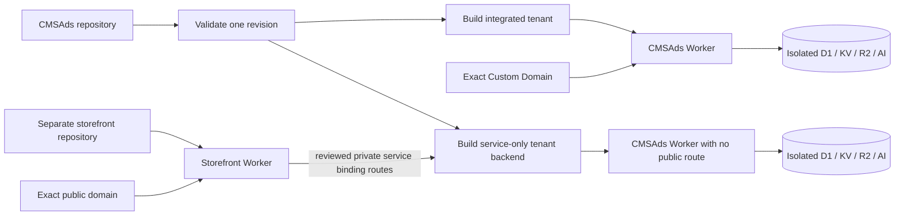
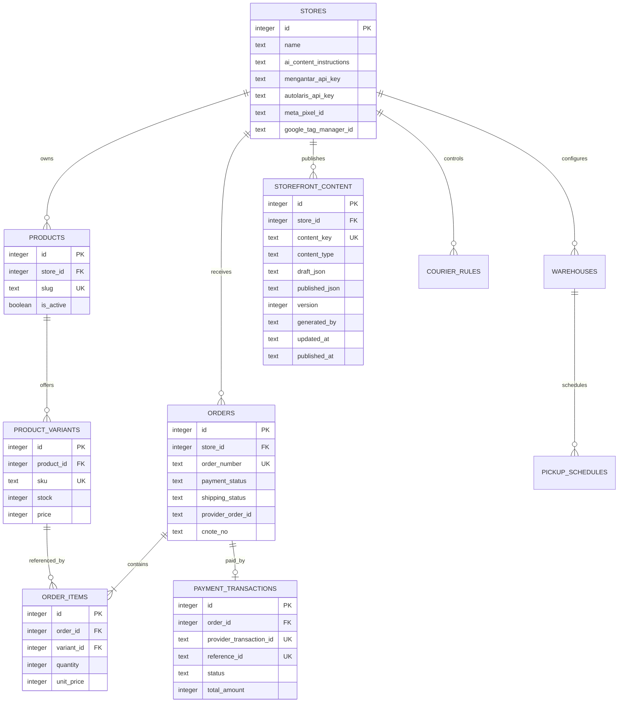
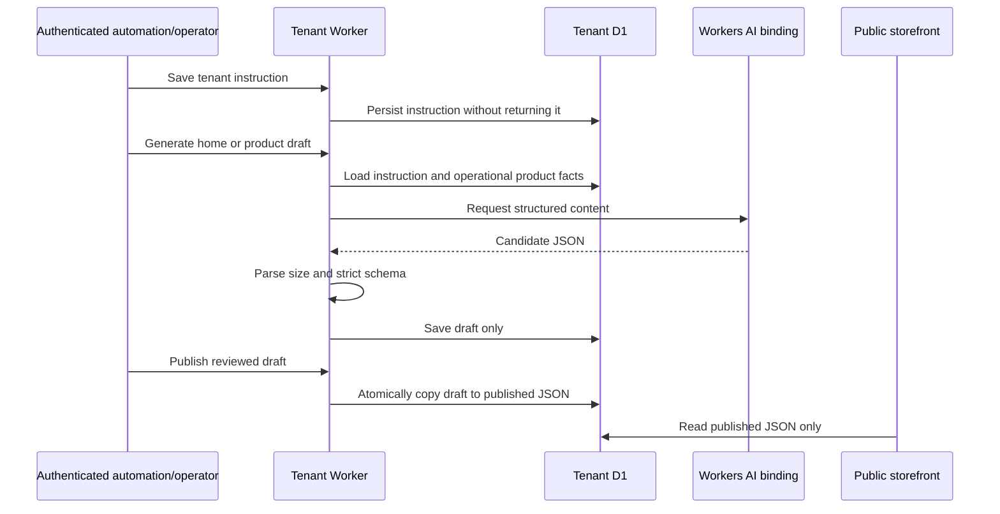
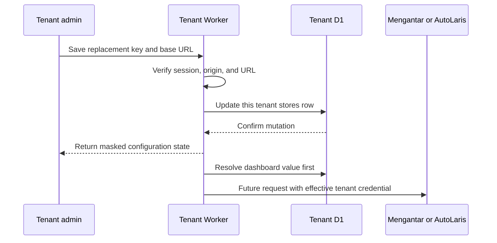
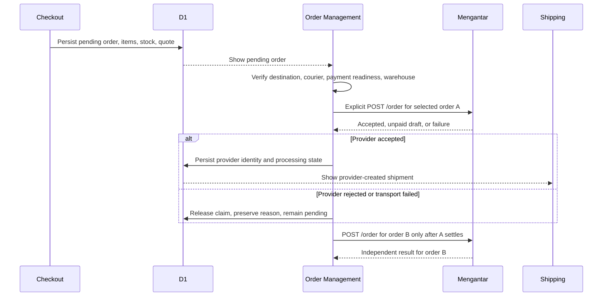

# PLAN: Runtime AI Content and Multi-Worker Fleet

## Scope and Evidence

- **Observed:** `wrangler.jsonc` currently registers only `petanisejahtera-preview` as a `custom-domain` Worker with isolated D1, KV, R2, and Workers AI bindings.
- **Observed:** D1 owns product/variant operations, orders, Meta/Google settings, warehouse/courier state, masked Mengantar/AutoLaris credentials, access control, and runtime storefront content. Both storefront submit endpoints use shared atomic D1 order persistence.
- **Decision:** Keep deployment-per-tenant isolation. Do not add runtime hostname dispatch or share one D1 database between tenants.
- **Decision:** Keep storefront template selection at build time, but keep tenant copy and generation instructions in runtime D1. The repository owns schemas, renderers, and behavior; R2 owns tenant media; KV remains session/quota storage.
- **Decision:** Workers AI may generate only a validated draft. An authenticated explicit publish action is the only path that changes public content; operational fields are outside the content schema.
- **Decision:** One Git revision is validated once and targets are derived from the validated tenant registry. Each Worker build/deploy is failure-isolated, while remote migrations remain a separate approval gate.
- **Observed:** The tenant installer can plan `custom-domain` or `service-only` ingress, creates isolated D1/KV/R2 resources, applies schema, and bootstraps only one store row plus one forced-rotation owner; its plan declares `importsExistingTenantData: false`.
- **Decision:** [`INSTALLATION.md`](./INSTALLATION.md) owns portable local bootstrap and new-account onboarding. [`STOREFRONT_INTEGRATION.md`](./STOREFRONT_INTEGRATION.md) owns the custom frontend, CMSAds form, gateway, and Meta Ads handoff.

## Platform Profile and Ownership

- **Profile:** `platform`
- **Overlays:** `multi-tenant`, `custom-domain`, `commerce`, `personal-data`, `ai-system`, `mobile-desktop`, `data-analytics`
- **Public brand metadata owner:** typed `PUBLIC_*` vars inside the selected Wrangler environment.
- **Commerce/state owner:** tenant D1 tables (`products`, `product_variants`, `orders`, `order_items`, `payment_transactions`, `courier_rules`, `warehouses`, `pickup_schedules`).
- **Runtime content owner:** tenant D1 `storefront_content` plus `stores.ai_content_instructions` for non-secret generation instructions.
- **Media owner:** tenant R2 bucket. **Session/quota owner:** tenant KV namespace.
- **Secret owner:** Cloudflare secret storage and local `.dev.vars.<tenant>` files. The AutoLaris webhook secret is intentionally not D1 state.
- **Observed:** runtime content operations are exposed through authenticated `/admin/content`, `/api/admin/content`, and `/api/admin/media` boundaries.
- **Unknown:** verified code covers the current Mengantar rate/address/order/history flow and the current AutoLaris payment flow, but the official Mengantar tracking/balance contracts and the official AutoLaris callback-signature contract are still unavailable.

## Deployment Topology



Each Wrangler environment repeats the complete non-inheritable binding and public-variable set. Stable application binding names (`OMS_DB`, `SESSION`, `ASSET_BUCKET`, `AI`) resolve to tenant-specific Cloudflare resources. The fleet workflow never copies content or credentials between Workers. The integrated Worker owns storefront, forms, admin, and API on its Custom Domain. A headless storefront owns public pages in a separate repository/Worker and delegates only reviewed operational routes to a `service-only` CMSAds backend; each Worker is built and deployed independently.

## Portable Installation and Storefront Ownership

| Contract | Status | Owner |
| --- | --- | --- |
| Lockfile-pinned local bootstrap with no Cloudflare side effects | Implemented | `scripts/install.sh`; runbook in [`INSTALLATION.md`](./INSTALLATION.md) |
| Isolated resource provisioning, schema/store/owner bootstrap, and `importsExistingTenantData: false` | Implemented | `scripts/install-tenant.ts`; operator approval remains required for remote mutation |
| Integrated `custom-domain` topology | Implemented | CMSAds Worker |
| Headless `service-only` topology | Supported; no active reference deployment | Separate storefront Worker plus CMSAds backend |
| CMSAds middle/full/hybrid form behavior | Implemented in CMSAds; headless locked-route handoff is planned | CMSAds |
| Custom public shell, layout, route hierarchy, motion, and copy presentation | Reference | Storefront repository |
| Public bootstrap/catalog APIs, locked form gateway routes, framework-neutral adapters, and consent propagation | Planned | CMSAds plus each storefront adapter |

A headless frontend may change presentation but cannot redefine canonical product/variant identity, price, stock, shipping, payment eligibility, form validation, order persistence, operator lifecycle, or server tracking. The CAPI token stays server-only; canonical D1 product IDs and a shared browser/server Purchase event ID cross the storefront boundary. A missing public adapter is a gap, not permission to expose secrets or duplicate commerce logic.

## Template and Runtime Content Contract

A tenant environment selects:

- `PUBLIC_STOREFRONT_TEMPLATE`: a registered public layout bundle.
- `PUBLIC_ADMIN_NAME`: operator-facing tenant identity.
- `PUBLIC_SITE_*`: canonical origin, public brand, logo, locale, and theme color.
- `PUBLIC_CONTENT_PACK`: the existing Petani Sejahtera migration fallback only; it is not the target content source.

The registered template bundles are:

| Template         | Home behavior                                            | Commerce behavior                               | Intended use                                        |
| ---------------- | -------------------------------------------------------- | ----------------------------------------------- | --------------------------------------------------- |
| `compact-market` | Centered 480px mobile commerce home                      | Shared D1 catalog, funnels, forms, and checkout | Mobile-first direct-response tenants                |
| `wide-catalog`   | Wide editorial catalog home with responsive product grid | Same shared D1 catalog, forms, and checkout     | Merchants needing a distinct brand/storefront shell |

Runtime content is keyed as `home` or `product:<D1ProductId>`. D1 stores the tenant instruction plus draft and published structured JSON. Home content owns hero, catalog, solutions, and proofs presentation; product content owns editorial fields and reviews. D1 `products` and `product_variants` remain authoritative for activation, slug, immutable canonical IDs, price, stock, weight, and checkout. Current local fixtures use `10001`/`20001`-style D1 integers; new records continue the same D1 identity sequence without a second provider namespace. An inactive product may receive content before activation.

## Route Sketch

```mermaid
flowchart TD
    Domain[Exact tenant domain] --> Worker[Tenant Worker]
    Worker --> Home[/]
    Worker --> Catalog[/produk]
    Worker --> Product[/produk/:slug]
    Worker --> Campaign[/campaign slugs]
    Worker --> Forms[/hybrid-form, /middle-form, /full-form]
    Worker --> Thanks[/thanks]
    Worker --> Admin[/admin/*]
    Worker --> Api[/api/*]
    Home --> Template[Build-selected home template]
    Template --> Published[Published runtime content]
    Product --> Published
    Published --> D1[(Bound tenant D1)]
    Catalog --> SharedCommerce[Shared commerce routes]
    Campaign --> SharedCommerce
    Forms --> OrderPersistence[Atomic D1 order persistence]
    Admin --> TenantAdmin[Tenant-branded operations shell]
    Api --> BoundData[Bound D1, KV, R2, and AI only]
```

Route paths stay stable across Workers. Template selection occurs at build time; data and content resolve only through that Worker's bindings. This preserves analytics selectors, checkout contracts, canonical paths, and one shared operational code path without request-hostname dispatch.

## D1 Isolation and Logical Schema



This schema is instantiated separately in every tenant D1 database. No `tenants` table or request-derived `tenant_id` is added because physical Worker bindings are the security boundary. A future shared-D1 SaaS model would require a separate migration and query audit.

## AI Content Lifecycle



An AI failure, invalid schema, missing instruction, or publish-without-draft leaves the current published record unchanged. Raw HTML and operational fields are rejected by schema rather than filtered after generation.

## Provider Replacement Flow



An empty key preserves the current key. The provider webhook secret remains a server secret and is never stored or returned through the admin panel.

## Explicit Order Release Flow



- **Decision:** Every checkout path ends at persisted `pending` Order Management state. COD and authenticated paid reconciliation affect eligibility but never trigger Mengantar automatically.
- **Decision:** Order Management owns destination/courier/payment/warehouse verification and the explicit single or checklist bulk Push to Mengantar. There is no local confirmation state between verification and provider creation.
- **Decision:** Only a provider-accepted response may persist `provider_order_id` and transition the order to `processing` for Shipping. Provider rejection or transport failure releases the dispatch claim, keeps the order pending, preserves an actionable reason, and remains retryable.
- **Decision:** Bulk execution is non-concurrent and partially successful by design. Results are reported per order as `success`, `unpaid`, `skipped`, or `failed`; accepted siblings stay committed.
- **Decision:** A provider-accepted unpaid draft may appear in Shipping with `isPaid: false` and absent `cnote_no`. Only a provider-returned waybill may be persisted or displayed.
- **Evidence:** `STATUS.md` Section 41 and `TASKS.md` Phase 66 record the focused contract, API, build, and desktop/mobile browser verification. QA intentionally did not submit a live provider mutation.

## Product Form Embed Contract — Implemented Locally

- **Decision:** Each active, checkout-complete product exposes canonical standalone URLs for `middle`, `full`, and `hybrid` modes, optionally locked to a canonical D1 variant ID. The URL remains the source of truth; no product-specific JavaScript bundle is generated.
- **Decision:** Product-list action menus open one integration dialog with mode and initial-variant controls, direct preview/copy, a plain responsive iframe, and an optional auto-height version.
- **Decision:** The iframe targets `/embed/form`, which server-renders the existing CMSAds form behavior. Parent JavaScript is not required. The optional adapter only validates and applies height messages from the exact CMSAds origin and iframe window.
- **Security boundary:** `/embed/form` is the only public surface allowed to be framed. It emits D1-backed tenant CSP `frame-ancestors`, omits `X-Frame-Options`, disables caching, and loads no base advertising tags. Owner/admin manage at most 25 exact HTTPS origins in Store & CS settings; domains and subdomains are separate origins, invalid input is rejected, stored empty means self-only, and D1 read failure fails closed. `PUBLIC_EMBED_ALLOWED_ORIGINS` is only the NULL-row cutover fallback. Admin, API, payment, confirmation, canonical form, and ordinary storefront routes retain `X-Frame-Options: DENY`.
- **Non-goal:** Do not serialize the rendered form into copied static HTML. A static clone would fork dynamic prices, stock, shipping, COD/payment policy, submit-token protection, and server tracking from CMSAds.
- **Evidence:** REQ-106/REQ-107 and TASKS Phase 67 own the contract. Local browser proof covers the action dialog at 390px, one same-origin iframe checkout creating exactly one pending order, scoped headers, no base tracking scripts, and rejection of an unlisted distinct origin. A listed distinct-origin deployment fixture remains T202 before release is claimed.

## CMSAds Landing-Page Widget — Implemented Locally

- **Decision:** The recommended integration is a framework-independent `<cmsads-form-widget>` custom element loaded from the same CMSAds tenant origin. Its explicit `product-id`, optional `variant-id`, and `mode` attributes always resolve to the canonical `/embed/form` route.
- **Progressive enhancement:** The copied element contains an eager fixed-height iframe, so checkout remains visible when the loader is blocked or late. The loader upgrades that same iframe rather than creating a second request, applies responsive width, and accepts auto-height messages only from the configured CMSAds origin and matching iframe window.
- **Isolation:** Unlike the studied Form ID widget, which injects a large checkout application directly into the parent DOM and loads its own Meta scripts, CMSAds keeps checkout state and styling inside the scoped iframe. The embed renderer continues to omit base advertising page-view tags, while provider, stock, shipping, payment, idempotency, and order persistence remain server-owned.
- **Compatibility:** Plain iframe and legacy inline auto-height outputs remain available under the advanced fallback section. The tenant origin allowlist remains mandatory; the loader does not and cannot bypass CSP `frame-ancestors`.

## District Discovery and Mengantar Resolution

- **Discovery boundary:** The embedded 2025 district catalog drives fast district-plus-city discovery only; its entries intentionally carry no provider area ID. The supplied 2024 spreadsheet is older and smaller, so it remains a reference rather than replacing the 7,285-row catalog.
- **Provider boundary:** Before quoting or saving shipping, CMSAds resolves the selected district and city through Mengantar. Administrative city prefixes are normalized for provider search and comparison, while exact normalized district plus city matching prevents same-name results from another city.
- **Failure boundary:** An empty local discovery ID is rejected before database quote work and before any Mengantar estimate request. `Cakung, Administrasi Jakarta Timur` resolves with the provider query `Cakung Jakarta Timur`; `BINUANG, CAKUNG, SERANG` cannot satisfy that pair.

## Implementation Boundaries

- Validate domains, Worker names, bindings, templates, and resource uniqueness before Astro or Wrangler runs.
- Resolve templates and admin identity at build time; resolve published copy from the active Worker's D1 at request time.
- Keep tenant instructions blank in schema, migrations, fixtures, and source control. Never return them from a read API.
- Keep product/variant IDs, prices, stock, Meta/Google, Mengantar/AutoLaris, warehouse/courier, and order lifecycle in the existing operations admin.
- Keep every newly submitted order pending in Order Management until an explicit eligible Push to Mengantar receives a provider-accepted response.
- Execute single/bulk Mengantar creation only from Order Management through one sequential queue; preserve per-order partial results, keep failures pending and retryable, and expose only provider-created shipments in Shipping.
- Derive fleet jobs from `tenant:list --json`; keep `fail-fast: false`, per-tenant concurrency, the existing deploy gate, and no automatic remote migrations.
- Retain compiled Petani Sejahtera content only as an explicit legacy migration fallback. Remove it after every required public route has reviewed published D1 content and R2 media.
- Provisioning, content publication, remote migration, deployment, Worker deletion, domain changes, and storage deletion are distinct approval-gated operations. Worker deletion never authorizes D1/KV/R2 deletion.
- For a new Cloudflare account, plan resource and ingress names first; never reuse another account's IDs or interpret committed IDs as proof that resources exist in the selected account.
- Provision only schema, one store row, one forced-rotation owner, and the immutable canonical sample: product `10001` (`aussie`, `Aussie Sample`) with variants `20001` (`500ml`, Rp150,000, `600g`) and `20002` (`1 Liter`, Rp300,000, `1100g`). Merchant catalog, content, media, customer/order/payment records, provider configuration, tracking credentials, sessions, and secrets require explicit tenant onboarding and are never imported.
- Keep public bootstrap/catalog contracts, the executable framework-neutral storefront adapter, complete Meta handoff proof, and cross-storefront consent in planned status until their traceable tasks and executable proof are complete. Canonical CMSAds routes and the reusable implementation prompt are implemented locally; this is not deployment proof.

## Phase 73: Cloudflare Maximum Acceleration Engine — Architecture & Execution Strategy

### Objectives

1. **Zero-Waterfall SSR Data Injection (Admin Pages)**: Eliminate double loading and spinner delay on `/admin/orders`, `/admin/products`, and `/admin/shipping` by fetching initial data in Astro server frontmatter (`Astro.locals.OMS_DB`) and passing it as `initialData` props to hydrated React islands (`<OrdersTable initialOrders={initialOrders} client:load />`).
2. **D1 Performance Indexing & Batching**: Add multi-column indexes (`orders(created_at DESC, id DESC)`, `orders(order_number)`, `products(is_active, created_at DESC)`, `order_items(order_id)`) and refactor multi-query APIs to execute in a single roundtrip via `db.batch([...])`.
3. **Cloudflare Edge Micro-Caching & KV Config Acceleration**: Inject Cloudflare Edge `Cache-Control` headers (`public, max-age=60, s-maxage=300`) on public storefront routes (`/api/form-config`, `/api/v1/products`) and cache public store settings in Cloudflare KV (`SESSION` binding) with a 300s TTL.

## Phase 74: Full-Funnel Ads Engine, SEO, Abandoned Lead Recovery & Mobile Speed Perfection - Strategy

### Objectives

1. **100% E2E Checkout & Abandoned Lead Recovery**: Ensure user form interactions record abandoned leads (`shipping_status = 'abandoned'`) on partial phone/name input via `/api/record-abandoned-order`, and update or convert existing abandoned orders to `pending` upon full submission without creating duplicate order rows.
2. **Multi-Platform Conversion Signals (Meta CAPI, Google Ads, TikTok Ads)**: Preserve `gclid`, `gbraid`, `wbraid`, `_fbp`, `_fbc`, `ttclid`, and `utm_*` parameters in session cookies and attach them to `orders.ad_click_ids`. Queue authoritative server CAPI `Purchase` events in `capi_event_outbox` with unique `event_id` (`order_number`).
3. **Mobile Core Web Vitals & SEO Perfection**: Inject JSON-LD structured schemas (`Product`, `Offer`, `BreadcrumbList`, `Organization`, `FAQPage`), optimize image loading (`loading="eager"` with `fetchpriority="high"` for hero, `loading="lazy"` for lower sections), zero layout shifts (`CLS = 0`), and optimize font rendering for fast mobile PageSpeed.
4. **Automated E2E Behavioral Smoke Testing**: Execute end-to-end tests validating checkout creation, abandoned lead recording, order state mutation, Meta CAPI queuing, and SEO markup integrity.
## Phase 75: Comprehensive System Precision & Expedient UI/UX Overhaul - Strategy

### Objectives

1. **Product & Landing Page Admin UX Precision**: Upgrade `ProductCatalog.tsx` and `LandingPageCatalog.tsx` with instant inline active/inactive toggle switches, one-click landing page duplication, live search filtering, and responsive filter badges.
2. **Order Management & CRM Workflow Precision**: Add quick status filter chips (`Semua`, `Terbengkalai`, `Menunggu`, `Diproses`, `Dikirim`, `Selesai`, `Batal`), bulk status update capabilities, and invoice search highlights to `OrdersTable.tsx` and `OrderDetail.tsx`.
3. **Developer Security & Access Manager UX Precision**: Add instant API key creation, key revocation, copy-to-clipboard functionality, and visual role access badges to `HeadlessApiManagement.tsx` and `AccessManager.tsx`.
4. **System Precision Regression Test Suite**: Add comprehensive unit and behavioral tests for catalog toggles, page duplication, bulk order updates, API key management, and security policies to `src/lib/system-precision.test.ts`.
