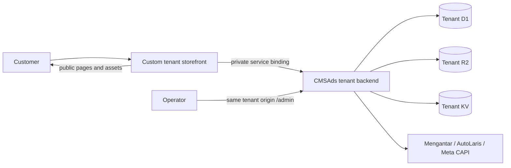

# CMSAds Storefront, Form, and Meta Ads Integration Contract

This document is the implementation handoff for an AI agent building a tenant-specific public storefront against CMSAds. The storefront may be completely custom. Commerce authority, checkout form behavior, tracking identity, order persistence, and operator lifecycle remain canonical.

## 1. Status Legend

- **Implemented:** present in the CMSAds repository and covered by current local evidence.
- **Historical evidence:** behavior recorded in Git history or the chronological build log, but not an active deployment or reusable runtime dependency.
- **Planned:** accepted target contract; implementation and executable proof still required.
- **Blocked:** requires an external provider contract or merchant input.

Do not present a planned adapter as an active endpoint.

## 2. Ownership Boundary

| Concern | Owner | Customizable per tenant |
| --- | --- | --- |
| Public layout, route hierarchy, components, motion, copy presentation | Storefront repository | Yes |
| Brand assets and merchant claims | Merchant-owned inputs and storefront/R2 | Yes, after factual review |
| Catalog identity, variant identity, price, stock, weight, active state | CMSAds tenant D1 | No browser override |
| Address resolution, courier eligibility, shipping quote | CMSAds API and provider contract | Presentation only |
| Checkout validation and order persistence | CMSAds API | Presentation only |
| Middle/full/hybrid form behavior | CMSAds system contract | Placement and mode selection only |
| Admin, order verification, shipping release, payment, provider state | CMSAds | No storefront fork |
| Meta/Google identifiers and CAPI secret | CMSAds tenant configuration | Per tenant, server-controlled |
| Browser event rendering | Storefront adapter | Yes, within the canonical event contract |
| Server CAPI and Purchase qualification | CMSAds | No browser authority |

A frontend deployment cannot read or copy another tenant's D1, KV, R2, secrets, sessions, orders, or provider credentials. A CMSAds deployment cannot replace a separate storefront bundle when the backend uses `service-only` ingress.

### Repository decision

- An **integrated** tenant does not require a separate frontend repository. Its public renderer, forms, admin, and API are built from the canonical CMSAds repository into one tenant-specific `custom-domain` Worker.
- A **headless/custom** tenant SHOULD use one separate storefront repository for that exact tenant. That repository owns public routes, framework, components, assets, domain, browser adapter, tests, and its own public release pipeline.
- The headless storefront repository MUST NOT fork CMSAds commerce logic. Admin, API, schema, authentication, order, payment, shipping, tracking guards, migrations, and provider integration remain in the canonical CMSAds repository and are deployed as the tenant's `service-only` backend.
- Storefront and backend repositories release independently. Their API and identifier contract remains a coordinated compatibility boundary.

## 3. Reference Headless Flow



No active headless gateway is registered. A future gateway MUST own its public domain and delegate only reviewed operational routes to a tenant-specific, `service-only` CMSAds Worker through a private `CMSADS` binding. Historical deployment evidence is not proof that such a gateway currently exists.

## 4. AI Storefront Build Workflow

### Step 1: Establish verified merchant inputs

Collect, without fabricating:

- tenant name, canonical domain, locale, support identity, and legal owner;
- product catalog and canonical CMSAds product/variant IDs;
- merchant-owned photography and logo;
- factual product claims, policies, guarantees, and testimonials with evidence;
- payment methods, COD policy, warehouse, courier constraints, and excluded provinces;
- Meta Pixel ID, CAPI readiness, GTM ID, Google Ads conversion pair, and consent requirements;
- target journey for each traffic source.

Missing merchant evidence remains empty or clearly marked as pending. Do not relabel Petani Sejahtera or another merchant's content.

### Step 2: Select the journey, not a template copy

| Journey | Use when | Recommended form |
| --- | --- | --- |
| Catalog | Customer compares multiple products before purchase | Product detail leading to `hybrid` or `full` |
| Direct-response COD | One offer, high mobile intent, eligible COD geography | `middle` or `hybrid` |
| Considered or prepaid | Shipping and payment choices must be explicit before submit | `full` |
| Mixed national traffic | Province changes COD or information requirements | `hybrid` |

The visual direction may be unique. Do not fork price, shipping, payment, order, or tracking rules to match a design.

### Step 3: Build the public shell

The storefront repository owns semantic HTML, responsive layout, navigation, product presentation, legal routes, performance, and accessibility. It must:

- preserve canonical product identity in every CTA and tracking event;
- keep critical content and form entry usable without animation;
- use 16px or larger mobile form controls and 44px touch targets;
- avoid horizontal overflow at supported mobile widths;
- expose honest loading, unavailable, error, and retry states;
- never imply order success before CMSAds returns a persisted order;
- never send personal data to analytics destinations outside the approved tracking contract.

### Step 4: Wire the gateway

**Canonical CMSAds route families:**

- storefront-owned: `/`, product, category, campaign, legal, and static asset paths;
- CMSAds-owned: `/admin/*`, `/api/*`, `/hello`, `/payment`, `/thanks`, `/hybrid-form`, `/middle-form`, and `/full-form`.

The canonical routes are `/hybrid-form`, `/middle-form`, and `/full-form`. Existing `/form-hybrid`, `/form-middle`, and `/form-full` links remain functional through permanent redirects to the corresponding canonical route with the complete query string preserved. New integrations should emit canonical URLs. A service-only tenant remains unreachable directly from the public Internet: its separately owned storefront gateway must delegate both canonical routes and any compatibility paths it promises through that tenant's private binding. Local CMSAds proof establishes the form routes, not deployment of a headless gateway.

### Step 5: Integrate data contracts

Current public CMSAds routes include:

| Route | Current role |
| --- | --- |
| `GET /api/form-config` | Resolve one active product/variant and canonical middle/full/hybrid render URLs. |
| `GET /api/locations` | Search district/city and provider location identities. |
| `POST /api/shipping-rates` | Resolve server-authoritative eligible courier rates. |
| `GET /api/shipping-options` | Return configured public shipping choices. |
| `GET /api/payment-methods` | Return eligible payment methods and COD exclusions. |
| `POST /api/submit-order` | Persist the full/hybrid validated order. |
| `POST /api/submit-middle-order` | Persist the compact middle-order contract. |
| `GET /api/order-status` | Return recorded payment state for a known order. |
| `POST /api/meta-event` | Validate and forward supported server CAPI events when configured. |

**Planned headless gaps:**

- a public, non-secret storefront bootstrap contract for tenant identity and browser tracking configuration;
- a canonical public catalog/product read contract for dynamic external storefronts;
- a framework-neutral executable adapter that preserves event and attribution identity.

Until the public bootstrap and catalog contracts exist, a new external storefront implementation is blocked from presenting a dynamic catalog. It must stop and report the backend prerequisite rather than inventing products, copying fixtures, or treating a manually aligned static catalog as synchronized.

## 5. Locked Form System

The long-term boundary is: tenant AI customizes the pages around checkout, while CMSAds owns the actual form state machine and mutation contract.

The storefront may choose:

- CTA position and surrounding section;
- form mode;
- canonical product and optional variant;
- brand-safe wrapper and transition into the system form;
- confirmation presentation based on the CMSAds response.

The storefront must not fork:

- field meaning or validation;
- product/variant identity;
- price, stock, weight, shipping cost, or COD rules;
- destination resolution;
- submit-token idempotency and bot boundary;
- payment qualification;
- order persistence;
- Meta event identity;
- success, invoice, provider, shipping, or waybill state.

### Middle form

**Implemented behavior:** compact variant selection plus customer name, WhatsApp number, full address, COD method, summary, and dedicated middle-order persistence. It is optimized for minimal direct-response friction.

**Boundary:** it still resolves the active D1 product/variant and cannot bypass server validation. It does not authorize automatic Mengantar dispatch.

### Full form

**Implemented behavior:** variant, name, WhatsApp, address, district/city search, selected location identity, eligible shipping/payment options, summary, and full order persistence.

**Use when:** geography, shipping, COD eligibility, or online payment must be resolved before submit.

### Hybrid form

**Implemented behavior:** CMSAds resolves trusted geo context from Cloudflare `request.cf.regionCode`, then verified province-name/header fallbacks. A known province that is eligible under the tenant policy resolves to middle mode. A province listed in the store-level `cod_disabled_province_codes`, or an unknown/unresolved province, resolves to full mode. Query parameters and routes cannot override canonical commerce validation.

**Policy boundary:** `cod_disabled_province_codes` is the merchant's store-level form-routing and COD policy. It is distinct from courier/provider service exclusions, which remain provider and shipping concerns. The admin currently presents all 38 Indonesian provinces and local proof observed 15 selected exclusions.

**Use when:** one landing page serves both fast eligible-COD traffic and traffic that requires explicit destination, shipping, and payment resolution.

### Required future hardening

- implement the public bootstrap and catalog contracts before a new external storefront renders commerce data;
- implement and prove a framework-neutral adapter without duplicating form markup or state;
- preserve source page, campaign, product, variant, event, click, and consent context across the handoff;
- return focus and errors accessibly;
- add contract tests for every declared supported frontend adapter;
- prove the selected tenant gateway and complete mobile/desktop customer journey before deployment.

## 6. Meta Ads Public Storefront Contract

### Configuration owner

The tenant's Ads & Tracking admin owns:

- Meta Pixel ID;
- masked Meta CAPI token;
- Meta Test Event Code used only for an explicit admin test;
- GTM container ID;
- Google Ads conversion ID and label pair.

The CAPI token is server-only and must never be returned to or embedded in the storefront. A blank admin token submission preserves the existing secret value.

CMSAds-rendered routes currently load Pixel and GTM configuration server-side from D1 with environment fallback. A standalone storefront does not yet have a committed public bootstrap endpoint; this is a planned adapter gap, not permission to expose the CAPI token.

### Canonical Meta event map

| Event | Browser trigger | Server rule | Required identity |
| --- | --- | --- | --- |
| `PageView` | Eligible page load after the tenant's consent rule allows it | Optional CAPI mirror through validated endpoint | Unique event ID when mirrored |
| `ViewContent` | Canonical product becomes the viewed product | Validate supported event and product payload | D1 product ID in `content_ids` |
| `AddToCart` | Current DR forms use qualified customer intent, not arbitrary scroll/click | Validate supported event | Product ID, value, currency, event ID |
| `InitiateCheckout` | Valid form submission begins | Validate supported event | Product ID, value, currency, event ID |
| `Purchase` | Only after CMSAds confirms the qualifying order state | CAPI uses the same Purchase event ID; unsupported or unqualified requests fail closed | Persisted order identity and canonical product ID |

Do not map page scroll, CTA impression, menu click, or form focus to `Lead` or `Purchase`.

### Deduplication

- Generate a dedicated Purchase event ID per order attempt.
- Browser Pixel and server CAPI must use the identical Purchase event ID.
- Do not reuse the funnel event ID for Purchase.
- Current `/thanks` logic guards both `Purchase_<purchase_event_id>` and `Purchase_order_<order_id>` in the browser.
- COD Purchase requires a successfully persisted order. Online Purchase waits for authenticated paid reconciliation.
- Refreshing or revisiting confirmation must not emit another Purchase for the same order.

### Product identity

`content_ids` is the canonical numeric D1 product ID represented as a string. A slug, SKU, frontend array index, provider ID, or campaign alias is not a valid substitute. The same ID must be used by storefront events, CAPI, and any connected Meta Commerce Catalog.

### Attribution and matching

- Preserve `_fbp` and `_fbc` as raw Meta browser identifiers; never SHA-256 hash them.
- Normalize phone to the accepted Indonesian international form before SHA-256 hashing.
- Trim and normalize names before hashing fields sent for Advanced Matching.
- Keep client IP and user agent server-derived where the API contract supports them.
- Preserve `gclid`, `gbraid`, and `wbraid` through the order handoff for Google attribution when the order schema supports those fields.
- Never place raw customer data, CAPI tokens, or payment data in URLs, logs, localStorage, dataLayer, or public configuration responses.

### Consent boundary

A tenant storefront must define the applicable consent behavior before loading optional browser tags. Tracking must not block checkout. Consent state, tag load, browser event, CMSAds acceptance, Meta API acceptance, attribution, and ad-platform reporting are separate facts.

The current repository has tracking validation and tag components but no completed cross-storefront consent/bootstrap adapter. Treat that as planned work and verify it before a new external storefront release.

### Verification checklist

1. Confirm Pixel ID is the intended tenant's ID; never inspect or expose the CAPI token in browser output.
2. Inspect browser network/dataLayer for the exact route and event.
3. Confirm `content_ids`, `value`, `currency`, and event name match D1 facts.
4. Confirm browser and CAPI Purchase share one event ID.
5. Confirm `_fbp`/`_fbc` are preserved un-hashed when present.
6. Confirm refresh/revisit does not duplicate Purchase.
7. Confirm COD and online Purchase gates differ correctly.
8. Use Meta Test Events only with an operator-provided test code and explicit outbound-call approval.
9. Record local validation separately from live Meta acceptance and attribution.

## 7. Order and Fulfillment Handoff

Every frontend ends at the same lifecycle:

1. CMSAds validates and persists the order with `shipping_status = pending`.
2. Order Management owns customer, destination, payment, warehouse, courier, and rate verification.
3. Explicit confirmation moves the order to Shipping as `processing` without calling Mengantar.
4. Shipping owns explicit single or checklist bulk Push.
5. Mengantar order creation is sequential and returns per-order outcomes.
6. Provider identity and `cnote_no` are stored only from accepted responses.

No storefront may dispatch Mengantar during checkout, infer a waybill, or skip operator confirmation.

## 8. Acceptance Criteria for a New Storefront

A storefront integration is complete only when:

- its repository and CMSAds tenant are named explicitly;
- its public routes remain owned by the storefront Worker;
- reviewed operational routes and `/hybrid-form`, `/middle-form`, and `/full-form` reach the correct service-only CMSAds tenant without changing browser origin;
- legacy `/form-*` paths are not exposed as aliases;
- no Petani Sejahtera or sibling-tenant content/data appears;
- product and variant data comes from the committed public bootstrap/catalog contracts; their absence blocks catalog implementation;
- location, rate, payment, submit, and confirmation failure states are exercised;
- known eligible, COD-disabled, and unknown province outcomes match CMSAds server policy;
- the chosen middle/full/hybrid form preserves canonical validation;
- Meta browser events use the correct tenant config, IDs, values, event IDs, and Purchase gate;
- mobile and desktop journeys have no page-level overflow, inaccessible controls, or silent errors;
- the target repository's checks, dry-run, and browser proof pass;
- remote migration, deployment, provider calls, test events, and data imports are reported separately.

## 9. Reusable AI Prompt: Build a CMSAds-Integrated Storefront

```text
You are implementing a production storefront that uses CMSAds as the tenant-isolated commerce and operations backend. The storefront may use any framework, repository, Cloudflare account, Worker name, or custom domain. Adapt to the target repository's installed stack and conventions; never assume Astro, React, Next.js, or a specific hostname.

INPUTS
- TARGET_REPOSITORY: <path or URL>
- CMSADS_TENANT: <tenant environment name>
- STOREFRONT_DOMAIN: <exact custom domain>
- STOREFRONT_WORKER: <exact Worker name>
- CMSADS_BINDING: <service-binding name, default CMSADS only when the target repo already uses it>
- MERCHANT_NAME / LOCALE / CURRENCY: <verified values>
- JOURNEY: catalog | direct-response | mixed
- APPROVED_BRAND_ASSETS_AND_COPY: <paths or source>

NON-NEGOTIABLE BOUNDARIES
1. Inspect the target repository, package scripts, routing, deployment config, CMSAds contract, and current working tree before editing. Reuse its framework and components. Do not add a framework or dependency when native code suffices.
2. The storefront owns public presentation, navigation, product merchandising, accessibility, legal pages, and responsive layout. CMSAds owns product and variant identity, price, stock, weight, location resolution, courier eligibility, shipping quote, payment eligibility, order persistence, tracking identity, and the Order Management -> Shipping -> Mengantar lifecycle.
3. Keep every tenant isolated. Never select a database from an untrusted Host header, share D1/KV/R2 data across tenants, expose provider credentials, or call another tenant's Worker. Use the target tenant's reviewed private service binding or same-origin gateway.
4. Never deploy, migrate remote D1, write production data, configure DNS, rotate secrets, send Meta test events, or call Mengantar without exact single-tenant operator approval.
5. Do not invent products, testimonials, claims, discounts, stock, shipping rates, payment availability, Pixel IDs, or API fields. Missing contracts are blockers, not permission to ship static or fake data.
6. Use no decorative or scroll animation. The complete purchase path must work with JavaScript-reduced conditions where the installed stack permits, keyboard navigation, visible focus, 44px touch targets, 16px mobile inputs, reduced motion, and no horizontal overflow.

REQUIRED ARCHITECTURE
- Keep storefront routes and assets in the storefront Worker.
- Delegate CMSAds-owned routes to the exact tenant backend through the reviewed gateway/service binding: /admin/*, /api/*, /hello, /payment, /thanks, /hybrid-form, /middle-form, and /full-form.
- Do not recreate CMSAds checkout markup or validation in the storefront. Product CTAs pass canonical product_id and optional variant_id to the CMSAds form URL.
- /hybrid-form is the default mixed-traffic entry. CMSAds resolves Cloudflare request.cf.regionCode first, then verified province-name/header fallbacks. A known eligible province renders middle mode; a COD-disabled or unknown province renders full mode.
- /middle-form is the compact eligible-COD flow. /full-form requires destination search, server-authoritative shipping options, and eligible payment selection.
- COD-disabled province policy comes from tenant CMSAds admin configuration. The storefront may explain the outcome but may not override it. COD must be hidden in UI and rejected by the server when ineligible.

DATA AND COMMERCE INTEGRATION
1. Fetch tenant-owned catalog data from the committed public catalog/bootstrap contract. Use canonical D1 product IDs and variant IDs everywhere. If that endpoint is absent, stop and report the backend prerequisite; do not fall back to hard-coded products.
2. Render loading, empty, unavailable, out-of-stock, error, and retry states. Never show a stale price as authoritative.
3. Resolve a selected product/variant through GET /api/form-config and use only returned canonical form URLs.
4. Full checkout uses GET /api/locations, POST /api/shipping-rates, GET /api/shipping-options, GET /api/payment-methods, and POST /api/submit-order according to the checked-in CMSAds request/response schemas.
5. Middle checkout uses POST /api/submit-middle-order. Neither checkout may call Mengantar.
6. After CMSAds confirms order persistence, COD may continue to `/thanks`. Online payment must continue to `/payment`, render only the returned provider instructions, poll with the returned order/status identifiers, and reach `/thanks` only after paid reconciliation.
7. Operator fulfillment remains explicit: a persisted order enters Order Management as pending; operator confirmation changes it to processing and makes it visible in Shipping; only Shipping can perform selected single/bulk sequential Push to Mengantar; waybill/provider IDs are stored only from accepted provider responses.

PAYMENT AND SHIPPING
- Render only payment methods and courier services returned as eligible by CMSAds.
- Never trust browser-calculated totals, shipping costs, discounts, COD fees, stock, or weights.
- Online Purchase tracking waits for authenticated paid reconciliation. COD Purchase tracking requires a successfully persisted qualifying order. Checkout is never provider dispatch.
- Preserve explicit error messages for unavailable destination, no courier, COD exclusion, quote expiry, payment rejection, duplicate submit token, and backend unavailability.

META ADS, GOOGLE ADS, ATTRIBUTION, AND CONSENT
- Read only public, non-secret browser configuration from the committed CMSAds bootstrap/tracking contract. Meta CAPI tokens and provider credentials remain server-only.
- Preserve canonical product ID in content_ids. Use one unique event_id per event and the identical Purchase event_id for browser Pixel and server CAPI deduplication.
- Emit PageView, ViewContent, AddToCart/qualified intent, InitiateCheckout, and Purchase only at their documented lifecycle points. A click, scroll, form focus, or page impression is not Purchase.
- Preserve _fbp and _fbc without hashing. Normalize and hash supported customer fields only server-side per the checked-in tracking spec. Preserve gclid, gbraid, and wbraid through the order handoff when the schema supports them.
- Implement the merchant's applicable consent behavior before optional tags load. Tracking failures must not block checkout. Never place personal data, tokens, or payment data in URLs, logs, localStorage, dataLayer, or public config.

IMPLEMENTATION SEQUENCE
A. Audit and report the exact current route/data/tracking contracts and gaps.
B. Define a route ownership table and request/response adapter before visual work.
C. Implement responsive public catalog/product pages using dynamic canonical data.
D. Wire product/variant CTAs to the three canonical CMSAds forms without duplicating form state.
E. Wire payment, courier, order confirmation, thanks, ads tracking, attribution, and consent.
F. Add behavior tests only for new observable contracts and reuse existing test conventions.
G. Run the target repository's smallest checks, build/dry-run, and browser smoke at desktop and 390x844 mobile. Exercise keyboard navigation, one eligible province, one COD-disabled province, unknown geo, failed API, successful persisted order, and refresh deduplication. Verify no console errors, failed first-party requests, or horizontal overflow.
H. Report exact files changed, commands/results, unverified external-provider states, blockers, and remote actions not performed.

DONE WHEN
- Public catalog and products are dynamic and tenant-canonical, not duplicated fixtures.
- /hybrid-form, /middle-form, and /full-form reach the correct CMSAds tenant on the storefront domain.
- Eligible, excluded, and unknown province behavior matches CMSAds server policy.
- Payment, courier, totals, order persistence, confirmation, and fulfillment handoff preserve backend authority.
- Meta/Google identity, consent, and Purchase deduplication match the repository tracking specification without exposing secrets.
- Desktop and mobile browser evidence covers the complete customer path with no animation dependency or horizontal overflow.
- No remote mutation or deployment was performed without explicit approval.
```
