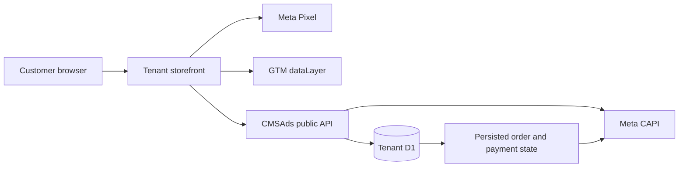

# CMSAds Meta Pixel, CAPI, GTM, and Google Ads Specification

This document owns the technical tracking contract for CMSAds-rendered and standalone tenant storefronts. It covers event semantics, identity, browser/server boundaries, deduplication, tenant configuration, and verification. It does not claim attribution certainty, legal compliance, consent applicability, or live provider acceptance.

## 1. Architecture



The storefront owns browser tag loading and event presentation. CMSAds owns tenant tracking configuration, public payload validation, canonical catalog/order identity, Purchase qualification, and server CAPI credentials.

A standalone storefront may use a different framework and design, but it must not fork event meaning, product identity, or Purchase qualification.

## 2. Current Implementation Boundary

### Implemented in CMSAds-rendered routes

- `MetaPixelBase.astro` resolves a valid tenant Pixel ID from D1 with environment fallback.
- `GtmBase.astro` resolves and validates the tenant GTM container ID.
- `GoogleAdsBase.astro` resolves a complete Google Ads conversion ID/label pair.
- page, product, landing, and thanks trackers emit the supported browser events.
- `/api/meta-event` accepts only supported event names and validates event ID, same-origin source URL, product/value payload, and bounded customer data before CAPI dispatch.
- `/admin/ads/meta` manages Pixel ID plus masked CAPI readiness and supports an explicit Test Events request.
- `/admin/ads/google` manages GTM independently and validates the Google Ads conversion pair.
- `/thanks` gates Purchase from recorded order/payment state and uses browser duplicate guards.

### Not yet implemented for arbitrary standalone storefronts

- a public non-secret storefront bootstrap endpoint for Pixel/GTM/Google browser configuration;
- a framework-neutral tracking adapter package;
- a completed cross-storefront consent adapter;
- automated verification across every external storefront repository.

Do not expose `meta_capi_token` to solve the bootstrap gap. See [`STOREFRONT_INTEGRATION.md`](./STOREFRONT_INTEGRATION.md) for the planned adapter boundary.

## 3. Tenant Configuration

`getStoreAdsConfig(locals)` resolves:

- `meta_pixel_id` and `meta_capi_token`;
- `google_tag_manager_id`;
- `google_ads_conversion_id` and `google_ads_conversion_label`.

D1 values take precedence over environment fallback. Changes in Ads & Tracking apply to subsequent CMSAds requests without rebuilding the Worker.

Security rules:

- CAPI tokens and webhook secrets are never returned by read APIs;
- blank token submissions preserve the active secret;
- Google Ads conversion ID and label are both present or both absent;
- tenant A configuration cannot be read through tenant B bindings;
- browser configuration may contain only non-secret identifiers.

## 4. Canonical Event Semantics

| Meta event | GTM event | Browser trigger | Qualification |
| --- | --- | --- | --- |
| `PageView` | `page_view` | Eligible page load | Tag and consent state permit browser tracking. |
| `ViewContent` | `view_item` | One canonical product is viewed | Canonical D1 product ID and current D1 value. |
| `AddToCart` | `add_to_cart` | Current direct-response form reaches qualified customer intent | Never a scroll, impression, or arbitrary CTA click. |
| `InitiateCheckout` | `begin_checkout` | A valid checkout submit attempt begins | Product, variant, value, and customer boundary have passed browser validation; server still revalidates. |
| `Purchase` | `purchase` | CMSAds confirms the qualifying persisted order state | COD requires persisted order success; online payment requires authenticated paid reconciliation. |

The repository does not map every interaction to `Lead` or `Purchase`. Analytics UI events must remain separate from optimization events.

## 5. Product Catalog Identity

Every product event uses the canonical numeric D1 `products.id`, encoded as a string in `content_ids`.

- D1 product ID: tracking and external catalog identity.
- D1 variant ID: order selection identity when variant detail is needed.
- Slug: routing label only.
- SKU: internal inventory label only.
- Frontend list index, campaign alias, provider ID, or legacy seed name: invalid tracking identity.

`ViewContent`, `AddToCart`, `InitiateCheckout`, browser Purchase, server CAPI Purchase, and any Meta Commerce Catalog integration must agree on the same product ID.

## 6. Event ID and Purchase Deduplication

A funnel event and a Purchase event must not reuse one ID.

1. Create a dedicated Purchase event ID for the order attempt.
2. Return and preserve that ID with the persisted order state.
3. Browser Pixel Purchase and server CAPI Purchase use the identical string.
4. The thanks flow applies both browser guards:
   - `once('Purchase_' + purchaseEventId)`;
   - `once('Purchase_order_' + orderId)`.
5. Refresh, revisit, duplicate callback, or repeated polling must not create another Purchase for the same qualifying order.
6. A new valid order receives a new Purchase event ID.

A local duplicate guard proves only the browser path. CAPI acceptance and Meta deduplication require a separately observed provider response.

## 7. Customer Matching and Attribution

### Hash before CAPI

Normalize and SHA-256 hash supported customer identifiers such as:

- phone after Indonesian international normalization;
- first and last name after trim and normalization;
- external ID when its canonical source is defined.

### Never hash Meta browser identifiers

Preserve `_fbp` and `_fbc` exactly as issued when present. They are attribution identifiers, not Advanced Matching fields. Do not place them in URLs or logs.

### Request-derived context

Client IP and user agent should be derived at the server boundary where supported rather than trusted from arbitrary browser fields.

### Google Click Identifiers & Attribution Preservation

Preserve `gclid`, `gbraid`, and `wbraid` through the checkout/order handoff when the active order schema supports them (`src/lib/order-schema.ts`). Do not invent storage or claim end-to-end attribution until the selected frontend and backend fields are verified.

## 8. Google Ads Conversion Signal Engine Protocol

### Architecture & Tag Integration

1. **Google Tag (`gtag.js`)**: Loaded dynamically by `GoogleAdsBase.astro` in the `<head>` of all storefront pages when valid `google_ads_conversion_id` (e.g. `AW-XXXXXXXXX`) and `google_ads_conversion_label` are configured for the active tenant.
2. **Google Tag Manager (GTM)**: Loaded by `GtmBase.astro` when `google_tag_manager_id` (`GTM-XXXXXXX`) is defined. Pushes ecommerce events (`page_view`, `view_item`, `add_to_cart`, `begin_checkout`, `purchase`) to `window.dataLayer` using GA4 / GTM standard schema.
3. **Global Execution Helper**: Exposes `window.__PS_PUSH_GOOGLE_CONVERSION__(value, transactionId, userData)` on client side to trigger Google Ads conversions safely.

### Enhanced Conversions for Web

Enhanced Conversions send SHA-256 hashed customer identifiers to Google Ads alongside the purchase event to improve conversion measurement accuracy when cookies are restricted:

- **Hashed Parameters**:
  - `sha256_phone_number`: Phone number normalized to E.164 without non-digits (`6281...`) hashed with SHA-256.
  - `sha256_first_name`: Customer first name normalized to lowercase hashed with SHA-256.
  - `sha256_last_name`: Customer last name normalized to lowercase hashed with SHA-256.
- **Frontend Boundary**: Executed inside `MetaThanksTracker.astro` upon order verification. The hashed `googleUserData` payload is passed to `window.__PS_PUSH_GOOGLE_CONVERSION__` which appends `user_data` to `gtag('event', 'conversion', payload)`.

### Consent Mode v2 Matrix

Google Consent Mode v2 signals default consent states before tags execute:

- Default Consent Flags:
  - `ad_storage`: `'granted'` (for direct advertising measurement)
  - `ad_user_data`: `'granted'` (for user data transmission to Google Ads)
  - `ad_personalization`: `'granted'` (for personalized remarketing)
  - `analytics_storage`: `'granted'` (for performance measurement)
- Merchant Policy: Storefronts can update consent state dynamically via `gtag('consent', 'update', { ... })` when a merchant cookie/consent banner is present.

### Transaction ID Deduplication

1. Every conversion payload sent to Google Ads includes `transaction_id: orderId` (using the canonical D1 order string ID, e.g. `ORD-XXXXXX`).
2. Deduplication applies across GTM ecommerce `purchase` events, direct `gtag` conversion events, and future Google Ads API Offline Conversion uploads.
3. Refreshing `/thanks` or revisiting the confirmation URL does not re-trigger Google Ads conversions due to `once('Purchase_order_' + orderId)` local guards.

### Smart Bidding & Target CPA / Target ROAS Signals

1. Conversion values are calculated using actual item prices multiplied by quantity (`productPrice * quantity`) in IDR currency.
2. COD orders qualify upon successful server order creation; Prepaid online orders qualify only after authenticated `is_paid: true` reconciliation.
3. Clear conversion signals feed Google Ads Smart Bidding algorithms (Target CPA, Target ROAS) without skewing reported ROAS with unverified checkout attempts.
## 9. Browser and Server Payload Boundary

Supported CAPI events are:

- `PageView`;
- `ViewContent`;
- `AddToCart`;
- `InitiateCheckout`;
- `Purchase`.

`/api/meta-event` rejects unsupported event names, malformed event IDs, cross-origin source URLs, invalid product IDs, invalid values/currency, and oversized customer payloads before any outbound call.

Conceptual Purchase data:

```json
{
  "event_name": "Purchase",
  "event_id": "purchase_<tenant-product>_<unique-order-attempt>",
  "event_source_url": "https://shop.example.com/thanks",
  "user_data": {
    "ph": ["<sha256-normalized-phone>"],
    "fn": ["<sha256-normalized-first-name>"],
    "fbp": "<raw-_fbp-if-present>",
    "fbc": "<raw-_fbc-if-present>"
  },
  "custom_data": {
    "content_ids": ["<canonical-d1-product-id>"],
    "content_type": "product",
    "value": 135000,
    "currency": "IDR"
  }
}
```

This example describes field meaning; it is not merchant data or a live credential.

## 10. Payment and Purchase Qualification

### COD

A successfully persisted COD order may qualify as Purchase because CMSAds has accepted the commercial order. Checkout persistence must succeed first. Shipping confirmation and Mengantar dispatch remain later operational states and do not create a second Purchase.

### Online payment

Order creation alone is not Purchase. `/api/order-status` reads the existing D1 order/payment state. Only authenticated AutoLaris paid reconciliation qualifies the online Purchase path. Unknown orders return `404`; unpaid or failed states must not be rewritten as Purchase.

Payment success, provider acceptance, ad-platform acceptance, attribution, and reported revenue are separate observable facts.

## 11. Consent and Privacy Boundary

Each tenant storefront must define applicable consent behavior before loading optional browser tags. The implementation must:

- avoid blocking checkout when analytics is unavailable;
- avoid raw personal or payment data in URLs, dataLayer, localStorage, logs, screenshots, or public config;
- distinguish required commerce storage from optional measurement storage;
- record consent state separately from event delivery;
- avoid claiming jurisdiction-specific compliance without a reviewed legal basis.

CMSAds currently has tracking components and payload validation but no complete framework-neutral consent/bootstrap adapter for external storefronts. This remains planned work.

## 12. Standalone Storefront Implementation Checklist

An AI agent implementing a new frontend must:

1. identify the exact CMSAds tenant and storefront repository;
2. obtain non-secret browser identifiers through an approved server-rendered or future public bootstrap contract;
3. keep the CAPI token inside CMSAds;
4. use canonical D1 product IDs for all supported events;
5. generate stable per-event IDs and a dedicated per-order Purchase event ID;
6. preserve `_fbp` and `_fbc` un-hashed when present;
7. normalize and hash Advanced Matching fields before CAPI;
8. preserve supported click identifiers through submit-order fields;
9. gate COD and online Purchase according to recorded backend state;
10. apply consent behavior without blocking the commerce journey;
11. inspect browser Pixel, dataLayer, and CMSAds API requests on the exact tenant origin;
12. record local browser evidence separately from Meta Test Events, live API acceptance, attribution, and campaign results.

## 13. Verification Contract

Run current repository commands rather than preserving historical counts:

```bash
npm test
npm run check
npm run tenant:build -- <tenant>
npm run tenant:dry-run -- <tenant>
```

For the selected storefront:

- inspect `PageView`, `ViewContent`, qualified `AddToCart`, `InitiateCheckout`, and Purchase triggers;
- verify `content_ids`, `value`, `currency`, event ID, source URL, and customer-data boundaries;
- verify browser and server Purchase use one event ID;
- verify refresh/revisit guards;
- verify COD and online gates;
- verify no CAPI token appears in HTML, JavaScript, network response, or logs;
- use Meta Test Events only with an operator-provided test code and explicit outbound-call approval.

A passing local test or build does not prove live Meta/Google acceptance, Event Match Quality, attribution, catalog health, or campaign performance. Record exact observed results and non-actions in `STATUS.md` and `BUILD-LOG.md`.
